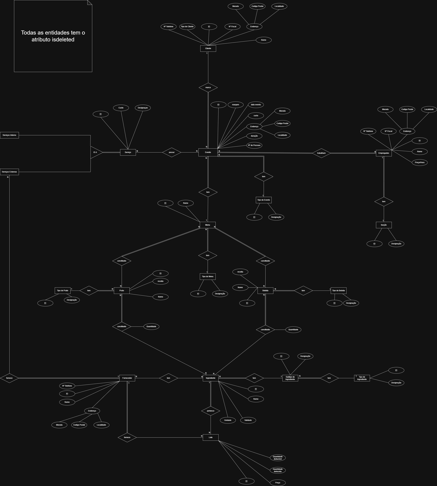
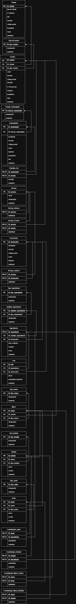
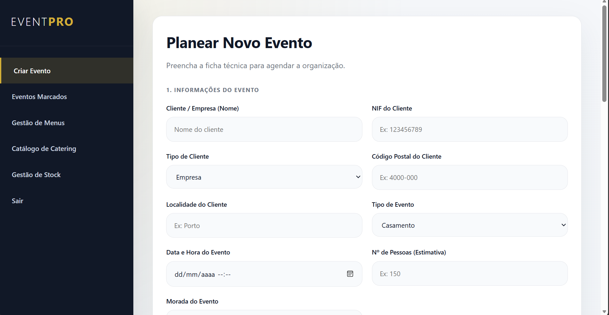
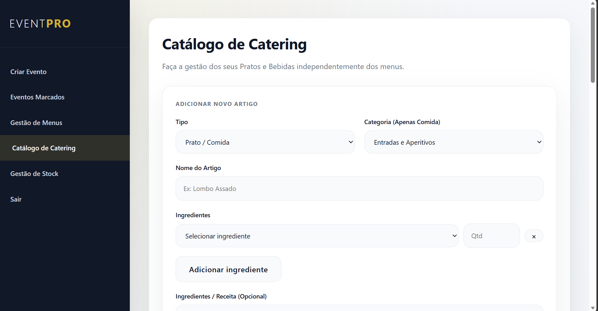
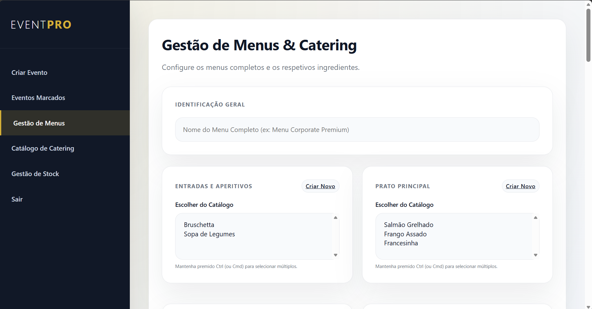
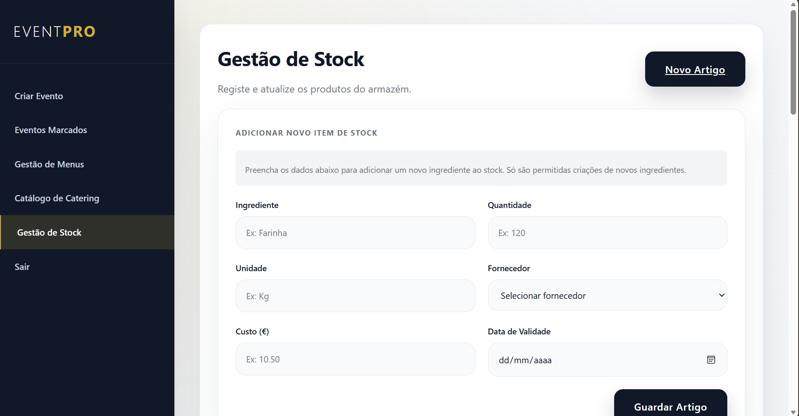

# BD: Trabalho Prático APF-T

**Grupo**: P5G8
- Íris Biaguê, MEC: 119251
- Tiago Ferreira, MEC: 78106

## Introdução / Introduction
 
O projeto consiste no desenvolvimento de uma base de dados para a **gestão de uma empresa de Catering**. O sistema visa centralizar e organizar toda a informação referente à planificação e execução de eventos, integrando a gestão de clientes, a alocação de recursos humanos e a estruturação detalhada de menus. O objetivo principal é otimizar a logística e garantir que cada evento tenha os recursos necessários sem desperdícios.

## ​Análise de Requisitos / Requirements


### Requisitos Funcionais (RF)
Os Requisitos Funcionais descrevem as ações e processos que o sistema deve ser capaz de realizar:

* **RF01 - Gestão de Clientes:** O sistema deve permitir registar, consultar, atualizar e remover dados dos clientes (Nome, NIF, Telefone, Morada).
* **RF02 - Gestão de Eventos:** O sistema deve permitir a criação, agendamento e orçamentação de eventos, associando-os a um cliente específico e definindo detalhes como data, local e o tipo de evento (ex: Casamento, Batizado).
* **RF03 - Gestão de Recursos Humanos (Staff):** O sistema deve permitir gerir os empregados, definir as suas funções (ex: Cozinheiro, Empregado de Mesa) e registar quais os empregados que trabalham em cada evento.
* **RF04 - Gestão de Gastronomia (Menus):** O sistema deve permitir a criação de menus estruturados, categorizando os tipos de menu, pratos e bebidas, bem como a constituição detalhada de cada prato/bebida (ingredientes e respetivas quantidades).
* **RF05 - Gestão de Fornecedores:** O sistema deve registar os fornecedores e monitorizar os produtos em stock, controlando a entrada de novos lotes (com as respetivas validades e quantidades).
* **RF06 - Gestão de Serviços Contratados:** O sistema deve suportar o registo de serviços adicionais necessários para o evento, distinguindo entre serviços internos da empresa e serviços externos (subcontratados a fornecedores), incluindo os seus custos.

### Requisitos Não Funcionais (RNF)
Os Requisitos Não Funcionais descrevem as restrições e as qualidades técnicas que a base de dados deve garantir:

* **RNF01 - Integridade de Dados:** O sistema deve garantir a integridade referencial rigorosa (ex: não permitir a eliminação de um cliente que tenha eventos agendados, nem a criação de um lote sem um produto e fornecedor associados).
* **RNF02 - Segurança e Privacidade:** Dados sensíveis, como o NIF e os contactos pessoais de clientes e empregados, devem ser protegidos e o acesso à base de dados deve ser restrito a utilizadores autorizados.
* **RNF03 - Escalabilidade:** O modelo de dados deve ser flexível o suficiente para suportar o crescimento da empresa, permitindo adicionar facilmente novos tipos de eventos, novos materiais ou categorias de menus sem necessidade de alterar a estrutura da base de dados.
* **RNF04 - Desempenho:** A estrutura relacional deve estar otimizada para permitir consultas (queries) rápidas, especialmente no cálculo de quantidades de ingredientes necessários para um grande evento ou na verificação de stock disponível.
* **RNF05 - Rastreabilidade:** O sistema deve garantir que o ciclo de vida dos produtos em stock (desde o fornecedor até à constituição do prato) seja totalmente rastreável para controlo de qualidade e validades.

## DER - Diagrama Entidade Relacionamento/Entity Relationship Diagram

### Versão final/Final version




### Melhorias/Improvements 
Foram efetuadas as seguintes alterações:

* Substituição da nota que indicava que todas as entidades possuem os atributos **"Criado em"** e **"Modificado em"** pela indicação de que todas as entidades possuem o atributo **"isdeleted"**.
* Retificação da obrigatoriedade na relação entre as entidades **Evento** e **Menu**.
* Remoção do atributo **custo** da entidade **Ingrediente**.
* Remoção da obrigatoriedade, em ambos os sentidos, na relação entre as entidades **Ingrediente** e **Fornecedor**, de forma a facilitar os *inserts*.
* Remoção da obrigatoriedade de um **Ingrediente** possuir um **Lote**, também com o objetivo de facilitar os *inserts*.

## ER - Esquema Relacional/Relational Schema

### Versão final/Final Version


### Melhorias/Improvements
Foram efetuadas as seguintes alterações:

* Criação da tabela **Constituicao_Menu_Pratos**.
* Criação da tabela **Constituicao_Menu_Bebidas**.
* Remoção do atributo **custo** da entidade **Ingrediente**.
* Adição do atributo **data** à entidade **Evento**.
* Adição do atributo **isdeleted** a todas as entidades.

**Nota:** As tabelas **Constituicao_Menu_Pratos** e **Constituicao_Menu_Bebidas** não foram criadas na APFE devido a um lapso.


## ​SQL DDL - Data Definition Language

[SQL DDL File](sql/01_ddl.sql "SQLFileQuestion")

Foram efetuadas as seguintes retificações ao DDL:

* Criação das tabelas **DDL.Constituicao_Menu_Pratos** e **DDL.Constituicao_Menu_Bebidas**.
* Criação dos *schemas*:
  * **DDL**
  * **SP**
  * **UDF**
  * **VIEWS**
* Criação de várias restrições por tabela, assegurando coerência com o DER.
* Colocação das tabelas no *schema* **DDL**.
* Adição do atributo **isDeleted** a todas as tabelas.

Foi criado um ficheiro *diff* para explicar as alterações efetuadas ao DDL.

[SQL DDL File alteration](01_ddl_alteracoes.diff "SQLFileQuestion")

## SQL DML - Data Manipulation Language

### 1. Formulário de "Criar Evento" (Página Inicial)




```sql
-- 1. Mostrar dados nos dropdowns do formulário (Ex: Tipos de Evento, Serviços, Empregados)
SELECT descricao FROM DDL.Tipo_evento WHERE isdeleted = 0;
SELECT id_servico, descricao FROM DDL.Servico WHERE isdeleted = 0;
SELECT * FROM VIEWS.V_Empregados_Evento;

-- 2. Inserir ou Atualizar um Cliente (verificação prévia)
SELECT id_cliente FROM DDL.Cliente WHERE NIF = @NIF;
-- Se não existir:
INSERT INTO DDL.Cliente (nome, NIF, tipo_cliente, codigo_postal, localidade) 
VALUES (@nome, @nif, @tipo, @cp, @localidade);

-- 3. Inserir um novo Evento usando a Stored Procedure
EXEC SP.sp_AdicionarEvento 
    @id_cliente = @id_cliente, 
    @id_menu = @id_menu, 
    @id_tipo_evento = @id_tipo_evento, 
    @morada = @morada, 
    @codigo_postal = @cp, 
    @duracao = 1, 
    @nr_pessoas = @pessoas, 
    @margem = 0, 
    @localidade = @localidade, 
    @data_evento = @data_sql, 
    @servicos = @servicos_str;

-- 4. Associar os empregados selecionados ao evento
INSERT INTO DDL.Trabalha_Em (id_empregado, id_evento, duracao) 
VALUES (@emp_id, @evento_id, 1);
```

### 2. Formulário de "Catálogo de Catering"



```sql
-- 1. Listar todos os pratos ativos agrupados com a sua categoria
SELECT P.id_prato, P.nome, P.receita, TP.designacao as categoria
FROM DDL.Prato P
JOIN DDL.Tipo_Prato TP ON P.id_tipo_prato = TP.id_tipo_prato
WHERE P.isdeleted = 0
ORDER BY P.id_prato DESC;

-- 2. Inserir novo Prato
INSERT INTO DDL.Prato (nome, receita, id_tipo_prato) 
VALUES (@nome, @receita, @id_tipo_prato);

-- 3. Associar os ingredientes ao Prato criado
INSERT INTO DDL.Constituicao_Prato (id_prato, id_ingrediente, quantidade) 
VALUES (@id_prato, @id_ingrediente, @quantidade);

-- 4. "Soft-Delete" de um Prato (Apagar)
UPDATE DDL.Prato SET isdeleted = 1 WHERE id_prato = @prato_id;
UPDATE DDL.Constituicao_Prato SET isdeleted = 1 WHERE id_prato = @prato_id;
```

### 3. Formulário de "Gestão de Menus"




```sql
-- 1. Inserir um novo Menu usando a Stored Procedure
EXEC SP.sp_AdicionarMenuCompleto 
    @id_tipo_menu = 1, 
    @descricao = @nome_menu, 
    @entradas_ids = @entradas,
    @pratos_principais_ids = @pratos_principais,
    @sobremesas_ids = @sobremesas,
    @bebidas_ids = @bebidas;

-- 2. Apagar um Menu (Soft-delete)
UPDATE DDL.Menu SET isdeleted = 1 WHERE id_menu = @menu_id;
```

### 4. Formulário de "Gestão de Stock"



```sql
-- 1. Listar todos os itens em stock usando a View dedicada
SELECT * FROM VIEWS.V_StockAtual;

-- 2. Registar entrada de um novo Lote (compras a fornecedores)
EXEC SP.sp_AdicionarLote 
    @id_ingrediente = @ingrediente_id, 
    @id_fornecedor = @fornecedor_id, 
    @preco = @preco, 
    @quantidade_deduzivel = @qtd_deduzivel;
```

## Normalização/Normalization

Para garantir a integridade dos dados e minimizar a redundância, a base de dados foi desenhada seguindo as regras da Terceira Forma Normal (3NF):
1. **1NF (Primeira Forma Normal):** Todos os atributos são atómicos. Por exemplo, em vez de ter um campo com vários telefones, ou uma string para os ingredientes de um prato, criámos tabelas associativas como `Constituicao_Prato` para que cada ingrediente seja uma linha individual ligada a um prato específico.
2. **2NF (Segunda Forma Normal):** Não existem dependências parciais. Nas tabelas com chaves primárias compostas (ex: `Servico_Evento` com `id_servico` e `id_evento`), todos os atributos não-chave dependem da chave inteira e não apenas de uma parte dela.
3. **3NF (Terceira Forma Normal):** Não existem dependências transitivas. Por exemplo, as categorias de pratos e menus foram extraídas para as tabelas `Tipo_Prato` e `Tipo_Menu`. A tabela `Evento` não armazena diretamente o nome do Cliente ou o nome do Menu, mas sim as respetivas chaves estrangeiras (`id_cliente`, `id_menu`), evitando duplicação e anomalias de atualização.

## Índices/Indexes

Para otimizar o desempenho do sistema, aplicámos diversas estratégias de indexação documentadas no script `sql/05_any_other_matter.sql`:

1. **Índices Non-Clustered nas Foreign Keys (FKs):** O SQL Server não indexa FKs por omissão. Como a aplicação depende fortemente de agregações (JOINs) – especialmente ligadas aos Eventos –, criámos índices nas chaves estrangeiras das tabelas principais.
```sql
CREATE NONCLUSTERED INDEX IX_Evento_Cliente ON DDL.Evento(id_cliente);
CREATE NONCLUSTERED INDEX IX_Evento_Menu ON DDL.Evento(id_menu);
CREATE NONCLUSTERED INDEX IX_Evento_TipoEvento ON DDL.Evento(id_tipo_evento);
```

2. **Índices de Pesquisa (Non-Clustered):** Como a aplicação realiza pesquisas frequentes por nomes de clientes, empregados e fornecedores, foram adicionados índices explícitos.
```sql
CREATE NONCLUSTERED INDEX IX_Cliente_Nome ON DDL.Cliente(nome);
```

3. **Índices Filtrados (Filtered Indexes):** Como utilizamos a estratégia de Soft-Delete (`isdeleted = 0`), criámos Filtered Indexes. Estes apenas indexam os registos ativos, reduzindo drasticamente o tamanho do índice e acelerando as leituras da aplicação.
```sql
CREATE NONCLUSTERED INDEX IX_Prato_Ativos ON DDL.Prato(nome) WHERE isdeleted = 0;
CREATE NONCLUSTERED INDEX IX_Bebida_Ativos ON DDL.Bebida(nome) WHERE isdeleted = 0;
```

4. **Modificação do Clustered Index (Tabela Evento):** Embora a Chave Primária (PK) seja `id_evento` (que por norma assume o índice clustered), forçámos a PK a ser `NONCLUSTERED` no script inicial (01_ddl). De seguida, aplicámos o **Clustered Index na coluna `data_evento`**. Como a visualização de eventos na aplicação é feita na sua maioria por intervalo de tempo (calendário), ter os registos fisicamente ordenados no disco pela data melhora enormemente a performance nas "range queries".
```sql
CREATE CLUSTERED INDEX CIX_Evento_DataEvento ON DDL.Evento(data_evento);
```

## SQL Programming: Stored Procedures, Triggers, UDF

A lógica de programação da base de dados encontra-se estruturada nos seguintes ficheiros:

[SQL SPs and Functions File](sql/02_sp_functions.sql "SQLFileQuestion")

[SQL Triggers File](sql/03_triggers.sql "SQLFileQuestion")

## Outras notas/Other notes

### Dados iniciais da dabase de dados/Database init data

[SQL DB Init File](sql/04_db_init.sql "SQLFileQuestion")

### Apresentação

[Slides](slides.pdf "Slides")

[Video](Gravação_demo.mp4 "Gravação")


 